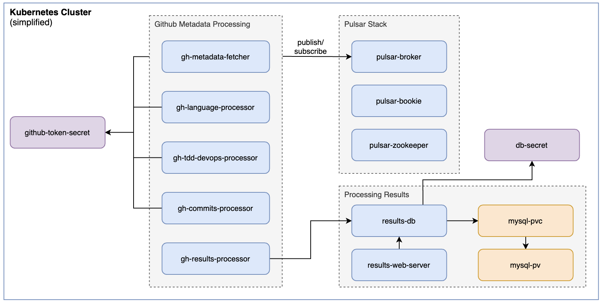

# DE2 - Project: Github analytic system

The project aims to develop a GitHub analytic system using Apache Pulsar to gain insights into repositories. By overcoming search and rate limit challenges in the GitHub API, metadata on recent open-source projects is collected. Through a layered topic design, the system processes this data to answer key questions, such as identifying top programming languages and projects. 

## Project Structure
For development purposes this github project is devided into the following subfolders:
- **openstack-setup**: outline the setup of a k3s cluster on OpenStack, including creating a master node with a floating IP and launching worker nodes using customized cloud-config files and a Python script.

- **services**: Contains the source code for processing and analytics pyhton files that are later deployed
- **simple-k8s-deployment-example**: Provides guidance on pushing a simple Python application to Docker Hub and deploying it in a Kubernetes environment
- **deployment**: Deployment Files and Guidline for the entire analytic system in Kubernetes, including the Pulsar Helm chart and other processing and analytics resources

## System architecture
The whole system is deployed in a Kubernetes environment (K3s) and has the following architecture:

